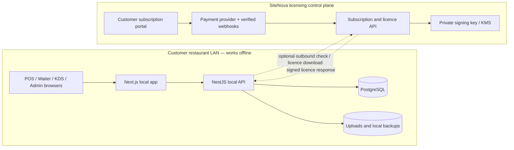

# SiteNova Restaurant ERP — Subscription & Offline Licensing Design

**Target branch:** `sitenova/phase-0-customization`  
**Status:** Architecture and implementation specification (not yet an activated licensing feature)  
**Product model:** Locally hosted, offline-first restaurant ERP sold on monthly or yearly subscriptions  
**Policy selected:** Manual and automatic renewal; seven calendar days of grace after expiry; read-only mode after grace  
**Data policy:** Never delete, encrypt-lock, or make customer business data inaccessible because a subscription expires.

---

## 1. Product and deployment principles

SiteNova is installed on a customer-controlled local server. The Next.js web app, NestJS API, PostgreSQL database, uploaded files, and realtime services run on that server. POS terminals, waiter devices, manager screens, and KDS connect to it over the restaurant LAN.

The central SiteNova licensing service is a separate control-plane service. It manages customers, plans, subscriptions, payments, licence issuance, and support operations. It is **not** in the request path for POS, orders, kitchen, printing, inventory, or reports.

### Non-negotiable requirements

1. An active local licence permits normal ERP operation without internet.
2. Temporary or permanent internet loss must not interrupt an active local installation.
3. Automatic renewal is best-effort when internet and the licensing service are available.
4. Manual renewal works by importing a signed licence file downloaded on any internet-connected device and transferred to the local server.
5. Licence verification is cryptographic and local. The local ERP contains only the public verification key; the private signing key never ships with the ERP.
6. After the subscription end date, allow a seven-day full-function grace period.
7. After grace, switch to read-only mode: allow login, viewing, searching, reports, printing/reprinting existing records, and export. Block new or modifying business transactions.
8. Never delete customer records, sales, invoices, reports, uploaded documents, backups, or database rows on expiry.
9. A licence expiry must not cause database schema changes, migrations, or automatic data cleanup.
10. A branch with a locally running server remains usable on its LAN even if the WAN is disconnected.

## 2. High-level architecture



The dotted connection is optional and outbound only. The local ERP must never need a live cloud call to authorize a normal POS request.

## 3. Subscription lifecycle

Suggested lifecycle states:

- `TRIAL`: optional trial period, governed by a signed trial licence.
- `ACTIVE`: paid period is current.
- `GRACE`: paid period has ended, but the seven-day grace window remains.
- `READ_ONLY`: grace has ended; data remains accessible but mutations are blocked.
- `SUSPENDED`: reserved for fraud, chargeback, or an explicit support action. Do not implement remote suspension in a way that requires a live connection or locks data.
- `CANCELLED`: no future renewal; access remains through the already-paid period and then follows grace/read-only rules.

A subscription record should use UTC timestamps for payment and validity boundaries. The UI should display dates in the restaurant's configured timezone. Define `validUntil` as an exclusive boundary: the paid period is active while `now < validUntil`. Grace is active while `validUntil <= now < validUntil + 7 days`. At or after `validUntil + 7 days`, read-only mode applies.

For date-based monthly and yearly plans, calculate calendar periods (e.g. one month or one year) rather than assuming every month is 30 days. Store the actual UTC validity boundary generated by the central billing service in the signed licence.

## 4. Renewal modes

### A. Automatic renewal (best-effort)

1. Customer opts in and adds a payment method in the hosted customer portal.
2. Central billing service attempts renewal through the payment provider.
3. Only a verified payment-provider webhook may mark an invoice paid.
4. The licensing service creates a new subscription period and signs a new licence.
5. When the restaurant server has internet, its scheduled check downloads the new signed licence and stores it locally.
6. If the restaurant is offline, nothing breaks. The current licence continues through its validity and grace window. The owner can import the new licence manually.

Do not store card data in the restaurant database. Use payment-provider tokens and hosted checkout/portal. Never trust a browser redirect as proof of payment.

### B. Manual renewal (offline-friendly)

1. Customer renews using the hosted portal on any internet-connected phone/computer, or contacts SiteNova support.
2. Licensing portal issues a signed `.sitelicense` file for the renewed period.
3. Customer downloads the file and transfers it by USB, local file share, or another approved method.
4. In local ERP, an owner opens **Settings → Licence → Import renewal**, selects the file, and confirms the restaurant/installation identity.
5. The backend verifies signature, product, installation binding, validity, plan, and monotonic licence generation before saving it.
6. The local audit log records who imported it, when, and the licence identifier.

A licence file is not a secret. Its signature is what makes it authentic. Do not accept unsigned JSON or editable expiry fields.

### C. Renewal conflict rules

- A newer signed generation for the same installation supersedes an older generation.
- A file for another customer or installation must be rejected with a clear message.
- A duplicate import is idempotent and must not extend the subscription twice.
- A renewal cannot shorten a currently valid paid period unless the central service explicitly signs a correction/revocation record and support procedure handles it.
- Clock rollback detection should be conservative: persist the greatest trusted local time seen and flag suspicious rollback. Do not permanently lock business data because the system clock is wrong; enter a recoverable licence-warning state and provide a support/import path.

## 5. Grace and read-only enforcement

### Policy

| Period | ERP behaviour |
|---|---|
| Before `validUntil` | Full features allowed |
| First 7 days from `validUntil` | Full features allowed, with persistent renewal warnings |
| At/after `validUntil + 7 days` | Read-only mode |
| After renewal is imported/received | Full mode restored immediately after successful verification |

### Read-only mode

Continue to allow:
- Authentication and user/role management only where needed to access/export records safely.
- Viewing and searching existing orders, bills, customers, inventory history, reports, staff records, and settings.
- Printing or reprinting existing receipts/reports.
- Exporting customer-owned data and downloading existing uploaded files.
- Database backup and restore operations.
- Licence viewing, renewal import, and support diagnostics.

Block:
- Creating, editing, deleting, or voiding orders and order items.
- New payments, refunds, discounts, gift-card redemption, loyalty mutations, or cash drawer transactions.
- Inventory adjustments, purchase orders, goods receipts, stock transfers, and waste postings.
- New reservations, table sessions, KOT changes, and other state-changing operational actions.
- Mutations through REST, WebSocket gateways, integrations, MCP, background jobs, and direct admin endpoints.

Do not rely only on hiding or disabling frontend buttons. Enforcement must be in the backend. Build a central licence guard/policy service and apply it to all mutation routes and realtime command handlers. Add explicit allow-list metadata for safe read-only operations. Test every mutation surface. Consider a transaction-level policy check for high-risk financial and inventory writes to avoid route omissions.

Never block read access to historical data. Do not make the app's only owner account inaccessible. Do not disable backup/export in read-only mode.

## 6. Signed licence payload

Use a versioned payload, canonical serialization, and Ed25519 signatures. Sign a deterministic canonical representation (e.g. RFC 8785 JSON Canonicalization Scheme) and verify the exact same bytes. The signing service keeps the private key in a KMS/HSM or protected secret store. The ERP embeds only the public key(s), with a key identifier for rotation.

Illustrative payload (not a real licence):

```json
{
  "schemaVersion": 1,
  "product": "sitenova-restaurant-erp",
  "licenseId": "lic_example",
  "customerId": "cus_example",
  "installationId": "install_example",
  "planCode": "YEARLY",
  "issuedAt": "2026-11-25T00:00:00.000Z",
  "validFrom": "2026-11-25T00:00:00.000Z",
  "validUntil": "2027-11-25T00:00:00.000Z",
  "graceDays": 7,
  "generation": 4,
  "limits": {
    "branches": 1,
    "devices": 10
  },
  "features": [
    "pos",
    "billing",
    "tables",
    "kds",
    "inventory",
    "reports"
  ],
  "keyId": "sitenova-license-2026-01"
}
```

The production file should be an envelope containing the payload and detached signature, encoded as JSON or a compact binary format. Never include private keys, payment secrets, or card data. Do not use a shared HMAC secret in the customer installation: a customer with server access could extract it and forge licences.

Installation identity should be generated at first setup and stored in protected persistent state. Avoid brittle hardware fingerprints that break when a disk, NIC, or motherboard is replaced. Provide a controlled rehost/reset workflow through the customer portal/support.

## 7. Proposed data model

Keep subscription billing records in the central licensing service. Keep only the signed licence and local enforcement state in each restaurant installation.

### Central licensing database (new separate service)

- `CustomerAccount`: customer identity and contact details.
- `ProductPlan`: plan code, billing interval, limits, feature entitlements, price/currency.
- `Subscription`: customer, plan, status, current period, cancellation state.
- `Invoice`: invoice number, amount, currency, due/paid status, payment provider reference.
- `PaymentEvent`: verified webhook event ID, provider, event type, processed timestamp; unique provider event ID for idempotency.
- `Installation`: installation ID, customer, branch/restaurant label, activation status, last check-in, rehost history.
- `LicenseIssuance`: licence ID, installation, generation, validity, key ID, payload hash, issued timestamp.
- `RenewalAttempt`: automatic/manual channel, result, timestamp, safe diagnostic code.
- `AuditEvent`: actor, action, target, timestamp, metadata with secrets/payment data redacted.

### Local ERP database

Store a minimal local record, for example:
- `installationId`
- `licenseId`
- `signedLicensePayload` (or payload bytes)
- `signature`
- `generation`
- `lastSuccessfulOnlineCheckAt`
- `lastTrustedTime`
- `licenseMode` (derived/cache only; always recompute from verified licence and time)
- `updatedAt`

The actual signed licence remains the source of truth. Do not store a local editable `isActive` boolean as the authority.

## 8. API and module boundaries

### Local NestJS API (proposed)

- `GET /api/license/status`: current mode, plan, expiry, grace end, installation ID, last check.
- `POST /api/license/import`: owner-only multipart/file import; verify and persist signed licence.
- `POST /api/license/check-now`: trigger best-effort online check; never block POS.
- `GET /api/license/export-request`: generate a non-secret installation/renewal request file for manual support.
- `GET /api/license/diagnostics`: safe diagnostics with no signing keys or payment secrets.

### Central licensing API (separate service)

- `POST /v1/installations/activate`
- `POST /v1/installations/check`
- `POST /v1/licenses/issue` (internal/admin only)
- `POST /v1/billing/webhooks/:provider`
- `GET /v1/customer/subscription`
- `POST /v1/customer/renew`
- `POST /v1/installations/rehost`

Authenticate installations with a per-installation credential, rotateable and revocable centrally. Use TLS, request signing or short-lived credentials, replay protection, rate limits, and idempotency keys. The online check should return a signed licence, not an unsigned status flag.

## 9. Proposed repository structure

Local application:
- `apps/backend/src/licensing/licensing.module.ts`
- `apps/backend/src/licensing/licensing.controller.ts`
- `apps/backend/src/licensing/licensing.service.ts`
- `apps/backend/src/licensing/license-verifier.service.ts`
- `apps/backend/src/licensing/license-policy.service.ts`
- `apps/backend/src/licensing/license.guard.ts`
- `apps/backend/src/licensing/dto/import-license.dto.ts`
- `apps/backend/src/licensing/types/license-payload.ts`
- `apps/backend/src/licensing/__tests__/`
- `apps/web/app/(dashboard)/settings/license/page.tsx`
- `apps/web/components/license/license-status-card.tsx`
- `apps/web/components/license/import-license-dialog.tsx`

Central licensing service (separate deployment/repository or isolated app):
- `apps/licensing-portal/` or a separate repository
- Customer portal, plans, subscriptions, invoices, payment webhooks, installation management, licence signing and support console.

Do not put the central private signing key in `apps/backend`, the frontend bundle, Docker image, GitHub Actions logs, or a customer .env file.

## 10. Implementation phases

### Phase A — Local licence foundation
- Generate stable installation ID on first run.
- Define versioned signed licence format and key rotation.
- Add local verifier and status endpoint.
- Add import/export renewal workflow.
- Add tests for valid, invalid, tampered, expired, wrong-installation, duplicate, and newer-generation licence files.

### Phase B — Grace and backend policy
- Implement paid/grace/read-only state calculation using UTC timestamps.
- Add centralized backend mutation guard and safe read-only allow-list.
- Audit REST controllers, WebSocket handlers, background jobs, integration endpoints, MCP actions, and admin operations for writes.
- Add comprehensive tests proving writes are rejected after grace and reads/exports/backups still work.
- Show persistent warnings without interrupting active operations.

### Phase C — Local UI
- Add Settings → Licence page with plan, status, dates, limits, features, installation ID, last online check.
- Add manual licence import and downloadable renewal request.
- Add expiry banners and read-only explanations.
- Ensure the page and file import work without internet.

### Phase D — Central portal and payments
- Build customer accounts, plans, monthly/yearly subscriptions, invoices and installation records.
- Integrate one payment provider using hosted checkout and verified webhooks.
- Add automatic renewal and signed licence issuance.
- Add customer portal download for manual licence file.
- Make payment/webhook processing idempotent and auditable.

### Phase E — Hardening and release
- Test WAN unplugged before, during, and after expiry.
- Test clock changes, server restarts, power loss, backup restore, key rotation, and licence rehost.
- Test all write endpoints after expiry, including realtime and integrations.
- Verify no customer data is deleted or hidden.
- Security review of signing key custody, webhook validation, local file import, and admin permissions.
- Publish migration/upgrade and support runbooks.

## 11. Acceptance criteria

1. A valid active signed licence allows all entitled features with no internet connection.
2. Pulling the WAN cable does not interrupt POS, billing, KDS, printing, or inventory.
3. Automatic renewal downloads and installs a new signed licence when internet returns.
4. Manual licence import renews an offline installation with no cloud access from the restaurant server.
5. A forged, malformed, wrong-product, wrong-installation, or older-generation licence is rejected.
6. During the seven-day grace window, full operations continue and warnings are visible.
7. At the exact grace boundary, all business mutations are blocked by the backend.
8. Read-only mode preserves historical viewing, search, reports, receipt reprints, data export, and backups.
9. Renewing after read-only mode restores operations without data loss or manual database repair.
10. Restarting/rebuilding containers preserves installation identity, licence state, database, and uploads.
11. No payment card details or private signing keys are stored on the restaurant server.
12. Existing customers and demo/development installs have a deliberate migration/trial path; do not accidentally lock existing installations when the feature first ships.

## 12. Existing project integration notes

The current branch already has a Next.js 16 frontend, NestJS 11 backend, PostgreSQL 16, Prisma, Socket.IO, and Docker Compose services with persistent `pg_data`, `uploads_data`, and `state` volumes. This design adds a local licensing module without replacing that stack.

The current Docker Compose includes an updater service that uses the Docker socket and downloads images on explicit administrator action. Keep application updates separate from subscription validation: no automatic image pull should be required for an active licence to keep operating.

The current repository is AGPL-3.0-only. Preserve its licence and required upstream notices. Review AGPL obligations and any separate commercial licensing strategy with qualified counsel before selling modified/hosted distributions.

**Implementation status:** This document records the approved design. It does not claim that subscription payments, cryptographic licence verification, grace enforcement, or read-only mode have been implemented or tested yet.
